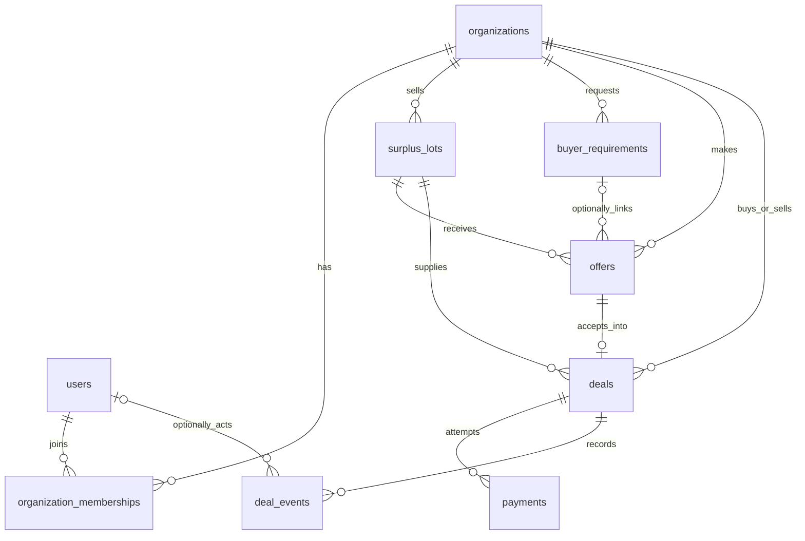

# Marketplace database

All nine entities use UUID primary keys. Timestamps are PostgreSQL `TIMESTAMPTZ` (UTC-aware in Python). `created_at` defaults on the server; SQLAlchemy updates `updated_at` when it emits an update. Business dates are interpreted in Asia/Karachi; expiry-day stock is excluded conservatively. Quantities are whole units, money is integer PKR paisa (Rs. 1 = 100 paisa).



## Field definitions

Every table has `id` and `created_at`. Every table except append-only `deal_events` also has `updated_at`.

| Entity | Domain fields |
|---|---|
| organizations | `name` (150), descriptive `business_type` (30), `verification_status` PENDING/VERIFIED/REJECTED, `city` (100), optional `area` (120), private `address`, `contact_email` (255), optional `contact_phone` (30), `is_active` |
| users | `full_name` (150), case-insensitively unique `email` (255), `is_active`; no passwords or login in this sprint |
| organization_memberships | `user_id`, `organization_id`, `role` OWNER/MANAGER/STAFF, `is_active`; one membership per user/organization |
| surplus_lots | `seller_org_id`, `product_name` (200), `category` (50), `description`, optional private `original_description`, `quantity_total`, `quantity_reserved`, `quantity_sold`, `unit` (30), `asking_unit_price_minor`, private `min_unit_price_minor`, `minimum_order_quantity`, `packaging_type` (50), `storage_type` (30), optional `manufacture_date`, `expiry_date`, `city` (100), `pickup_area` (120), private `pickup_address`, `pickup_deadline`, `resale_confirmed`, `information_confirmed`, `status` |
| buyer_requirements | `buyer_org_id`, `title` (200), `original_description`, `category` (50), `required_quantity`, `unit` (30), `max_total_budget_minor` including estimated buyer fee, `min_shelf_life_days`, `city` (100), optional `preferred_area` (120), `status` |
| offers | `lot_id`, `buyer_org_id`, optional `requirement_id`, `quantity`, `offered_unit_price_minor`, `status`, `expires_at` |
| deals | unique `offer_id`, `lot_id`, `buyer_org_id`, `seller_org_id`, `quantity`, `agreed_unit_price_minor`, `subtotal_minor`, `buyer_fee_bps`, `seller_fee_bps`, `buyer_fee_minor`, `seller_fee_minor`, `buyer_total_minor`, `seller_net_minor`, `currency` PKR, `status` |
| payments | `deal_id`, `provider` MOCK, positive `amount_minor`, `currency` PKR, `status`, optional `paid_at` (required on success) |
| deal_events | `deal_id`, optional `actor_user_id`, `event_type` (60), flexible JSONB `metadata` (mapped as `event_metadata` because SQLAlchemy reserves `metadata`) |

An organization can buy and sell regardless of descriptive business type. Verification status is stored for later review workflows; this local demo does not implement verification or production authorization.

## Integrity and inventory

Named foreign keys preserve relationships and restrict deletion of referenced records. Unique constraints enforce membership uniqueness and one deal per offer. Composite foreign keys keep a linked requirement under the correct buyer and a deal under the correct offer/lot/buyer.

```text
available_quantity = quantity_total - quantity_reserved - quantity_sold
quantity_total > 0
quantity_reserved >= 0
quantity_sold >= 0
quantity_reserved + quantity_sold <= quantity_total
```

No stored availability column exists. SQL checks enforce positive prices/budgets/quantities, minimum orders, chronological manufacture/expiry, reserve <= asking price, and publication confirmation for ACTIVE lots. API creation requires complete sealed inventory; complete DRAFT records may have unconfirmed flags, while publication requires confirmations. Partial drafts are not supported by the non-null columns. Status CHECKs support lot DRAFT/ACTIVE/PAUSED/SOLD_OUT/CLOSED/EXPIRED, requirement ACTIVE/PAUSED/FULFILLED/CLOSED, offer PENDING/ACCEPTED/REJECTED/WITHDRAWN/EXPIRED, deal AWAITING_PAYMENT/PAID/COMPLETED/CANCELLED, payment PENDING/SUCCEEDED/FAILED. CRUD updates, publication/pause, acceptance/rejection/withdrawal, payment and collection actions validate explicit state transitions.

Category, unit and city are normalized to lower case; common biscuit and pack aliases are mapped explicitly. Matching uses exact category/unit/city equality. Preferred area is informational. Shelf life and pickup deadlines are rechecked with the current clock, rather than time-dependent SQL CHECKs.

## Transactions and commission

Services own commits. Dependencies close sessions and roll back unfinished work. The demo organization lookup starts the request transaction; accepting an offer then locks the lot and offer, revalidates state/expiry/availability, increments reserved stock, creates its immutable deal snapshots and event, and commits atomically. Every stock-changing operation takes locks in lot-first order. A second acceptance of the same accepted offer returns its existing deal; competing offers for limited stock cannot both reserve it.

```text
subtotal_minor = quantity * agreed_unit_price_minor
fee_minor = (subtotal_minor * fee_bps + 5000) // 10000
buyer_total_minor = subtotal_minor + buyer_fee_minor
seller_net_minor = subtotal_minor - seller_fee_minor
```

Both rates default to 200 basis points (2%). Nonnegative fees round half up to the nearest paisa, without floating point. Example: 150 × Rs. 120 gives Rs. 18,000 subtotal, Rs. 360 on each side, Rs. 18,360 buyer total, Rs. 17,640 seller proceeds and Rs. 720 platform gross fees. SQL checks enforce snapshot arithmetic; a trigger prevents changing commercial snapshots. Seller acceptance is explicit; confidential reserve prices are never used to rank or classify buyer matches.

Checkout locks the lot then deal and creates/reuses a PENDING MOCK payment. Success callbacks mark the payment SUCCEEDED and deal PAID; failure allows a new attempt without marking the deal paid. A partial unique index forbids multiple successful payments per deal. PAID keeps stock reserved. Seller-confirmed collection moves reserved units to sold and marks COMPLETED. Unpaid cancellation releases stock and fails pending attempts; paid cancellation/refunds are outside scope. Payment is due one hour after created_at (a derived policy, no redundant deadline column), also constrained by pickup/product expiry; an explicit development cleanup command cancels overdue unpaid deals. All these transitions lock lot first. Deal history rejects updates/deletion, and callbacks do not duplicate events.

## Migration and test ownership

Revision `4191df3243ce` adds the nine domain tables and their constraints, indexes and triggers. Its upgrade was inspected before initial application; it does not drop existing tables. The Phase 3–8 extension retains this completed revision unchanged: existing fields/statuses already support the required lifecycle, so no unnecessary schema migration was created. No runtime `create_all()` is used.

`python -m app.testing` creates the separate `surpluslink_test` database if absent and applies the same Alembic revisions. Most database/API tests run inside an outer rollback transaction; service commits release savepoints without committing development data. Concurrency tests use independent real PostgreSQL connections and unique test records in that test database. These race-test records remain there for inspection and cannot affect development stock. Test database preparation requires the local Compose role's CREATEDB privilege (the Docker-initialized role is a local superuser); use a separate restricted role for any future hosted environment.

Seeds use deterministic UUIDs and `ON CONFLICT DO NOTHING` to preserve existing stock, reservations and expiry. Rerunning seed does not refresh expired demo lots. Use the repeatable HTTP demo command to create fresh demo inventory.
